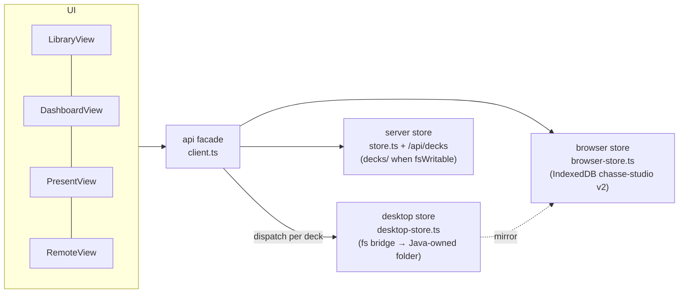
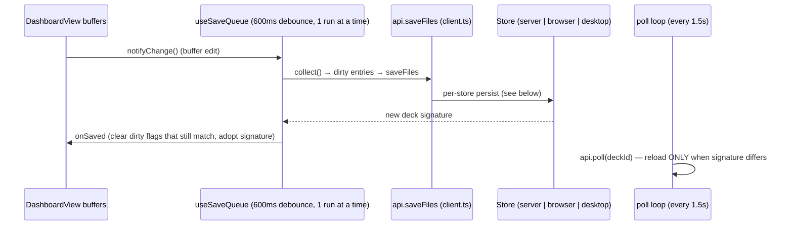

# Architecture

Modules, data flow and the bridge contract. All file references are in this
repo (`src/…`) unless stated otherwise; Java-side references are to the
sibling repo `chasse-desktop`.

## Module map

| Layer | Files |
| --- | --- |
| Views (one route, query-driven) | `src/app/page.tsx` (SSR initial data) → `src/components/stagesmith/ViewsShell.tsx` → `LibraryView / DashboardView / PresentView / RemoteView` |
| Client data facade (store dispatch) | `src/lib/stagesmith/client.ts` (`api.*`, `defaultStore`, `deckStoreOf`, `resolveModule`, module cache) |
| Store implementations | `store.ts` (server), `browser-store.ts` (IndexedDB), `desktop-store.ts` (fs bridge) |
| Desktop bridge | `desktop-bridge.ts` (v1 actions + events), `desktop-fs.ts` (v2 fs commands) |
| Device folders (browser store + File System Access API) | `device.ts` (write-through mirror), `permission.ts` (permission lifecycle) |
| Save pipeline | `src/hooks/useSaveQueue.ts` (used only by DashboardView) |
| Compiler | `src/lib/stagesmith/compile.ts` + `src/app/api/compile/route.ts` (esbuild) |
| Stage runtime | `public/runtime.html` + `src/app/runtime/route.ts`, wrapped by `StageFrame.tsx` |
| Sync | `src/hooks/useSync.ts`, `src/hooks/useDesktopServer.ts`, `mini-services/stagesmith-sync/index.ts` (socket.io) |
| Server API | `src/app/api/*` (decks, files, slides, snapshots, assets, compile, import, capabilities, network, fs, projects, qr, vendor) |

## The three stores

Decks live in ONE of three stores; every `api.*` call dispatches on it
(`src/lib/stagesmith/client.ts`):

| Store | Where | Owner | Notes |
| --- | --- | --- | --- |
| `desktop` | The folder chosen in the Chassé Studio desktop app | Java owns the folder, permission and every file operation via the fs bridge | Active whenever the bridge advertises `fs` AND a valid root is configured (`isDesktopFsActive()`) |
| `server` | The app's own `decks/` folder | This Next.js server | Only when the server FS is writable (`GET /api/capabilities` → `fsWritable`; local runs) |
| `browser` | This browser's IndexedDB (`chasse-studio` v2) | The browser | Hosted/read-only deployments, and first-run/fallback decks |

Dispatch rules (`client.ts`):

- `deckStoreOf(deckId)` — where does THIS deck live: **desktop wins when
  active** (`desktop.hasDeck`), else browser if `local.hasDeck`, else server.
- `defaultStore()` — where NEW decks go: **desktop > server > browser**
  (`desktop.isDesktopFsActive()` → `caps.fsWritable ? "server" : "browser"`).
- `api.listDecks()` merges all three; id collisions resolve desktop >
  browser > server (`listDecks` in `client.ts`).



The browser store additionally supports **device decks**: the record lives in
IndexedDB and `device.ts` mirrors every save into a user-picked folder through
the File System Access API (write-through, best-effort, diff-based and
serialized per deck).

## Editor data flow (the save pipeline)



- **One queue** (`useSaveQueue.ts`): debounced autosave 600 ms after the last
  keystroke; Ctrl+S / explicit flush skips the debounce; ONE run at a time —
  changes made while it runs merge into the next run; 30 s timeout per run;
  automatic retry ladder 1 s → 3 s → 10 s, then a `failed` state with the
  reason and a Retry button (buffers stay in memory). Logs every run as
  `[save] <n> file(s), <bytes> B in <ms>` in the console.
- **Crash recovery**: before risky moments (tab hide via `visibilitychange`,
  `pagehide`, `beforeunload`, and after a failed run) a copy of the dirty text
  buffers goes to localStorage as `ss-recovery::<deckId>` (≤ 2 MB total);
  DashboardView restores it on next open (only paths that still exist in the
  deck) and re-saves.
- **Per-store persist**:
  - server: sequential atomic PUTs, one per changed file
    (`PUT /api/decks/<id>/files` → `store.ts writeFileAtomic`: temp file +
    rename). Server decks get the whole batch as one list of PUTs; the last
    response's signature wins.
  - browser: ONE record mutation + a diff-based persist — text files by
    content hash, asset blobs one-per-key by identity/size (v2 split store).
  - desktop: diff writes — only files whose content actually changed go through
    `fs.writeText` (atomic on the Java side), removed files through `fs.delete`
    (`persistDiff` in desktop-store.ts).
- **Signature = poll key**: every save returns the deck signature on the SAME
  basis `api.poll` uses, so saves and polls always agree:
  - desktop: disk-walk over every non-hidden file, `path:size:mtime` hashed
    (`signatureFromRows`, walked with `fs.listFiles`) — so external edits
    (another window, VS Code) also move it;
  - browser: content hash of the in-memory record (`signatureOf` — fnv1a over
    per-file content hashes + asset size:mtime);
  - server: sha256 over the disk walk (`deckSignature` in store.ts).
- **Reload-on-change**: the dashboard polls `api.poll` every **1.5 s**, skips
  the tick when local buffers are dirty (never clobbers local edits) and for
  one tick after its own save, and reloads the bundle + resets buffers only
  when the signature differs (`DashboardView` "folder watching" effect) —
  this is the documented "last writer wins per file" limit when a deck is
  open in two places.

## THE BRIDGE CONTRACT (with chasse-desktop)

This is the reference. Both protocols run over the **same** `window.cefQuery`
CefMessageRouter channel that the desktop app injects (one-shot,
`persistent: false`, JSON-string requests). Everything here must stay
byte-compatible with `chasse-desktop`'s `DesktopBridge.java` / `FsService.java`.

### v1 — sync actions (`desktop-bridge.ts`)

Request `{id, action, payload}` → response `{id, ok:true, data}` or
`{id, ok:false, error}`:

| Action | Payload → data | Used by |
| --- | --- | --- |
| `getBridgeInfo` | → `{trusted, version, platform, appUrl}` — the only action an untrusted page may call | transport selection, trust gate |
| `getServerStatus` | → `{status: stopped\|starting\|running\|error, port, addresses[], selectedAddress, error}` | QrPanel / useDesktopServer |
| `getServerLog` | → log lines | QrPanel log tail |
| `startServer` / `stopServer` / `restartServer` | → server status | QrPanel |
| `selectAddress` | `{address}` | QrPanel interface picker |
| `joinRoom` | `{deckId, role, slides, slideId?, step?}` → `{state, token}` (a `sync-token` event also follows) | useSync (role display/editor) |
| `setSlide` | `{deckId, slideId, step}` | useSync.sendSlide |
| `nav` | `{deckId, dir}` | useSync.sendNav |
| `reportSteps` | `{deckId, slideId, steps}` | useSync.reportSteps |
| `syncDeck` | `{deckId, slides}` | useSync.syncDeck (after add/delete/reorder) |
| `setNotes` | `{deckId, slideId, note}` | PresentView notes-to-remote |
| `setUi` | `{deckId, qr?, overview?}` | PresentView ↔ phone UI state |
| `ping` | liveness probe | contract-defined; not called by the web app |
| `openDownloadFolder` | opens the folder of the last completed download → `{ok: boolean}` | "Open folder" toast action (useDownloadFeedback) |

### v2 — fs capability (`desktop-fs.ts`)

Request `{cmd, ...params}` → **raw contract shape** or error `{code, message}`
(never both — the client distinguishes errors purely by the `{code,message}`
shape, no `ok` wrapper):

| Command | Params → result |
| --- | --- |
| `hello` | → `{app:"chasse-desktop", version, capabilities:["sync","fs","downloads"]}` |
| `fs.getRoot` | → `{configured, path, valid}` |
| `fs.chooseRoot` | `{title?, startPath?, hint?}` → `{cancelled:true}` \| `{configured, path, valid}` (cancel is a clean answer, not an error) |
| `fs.listDecks` | → `[{id, title, folder, slides, modified}]` |
| `fs.readText` | `{deck, path}` → `{text}` |
| `fs.writeText` | `{deck, path, text}` → `{ok}` (atomic: temp file in the same folder → fsync → rename) |
| `fs.createDeck` | `{deck, files}` → `{ok, id}` (**deck.json written LAST**) |
| `fs.deleteDeck` | `{deck}` → `{ok}` (success only after the folder is verified gone) |
| `fs.duplicateDeck` | `{deck, copyId, title?}` → `{ok, id}` |
| `fs.listFiles` | `{deck, dir}` → `[{name, size, modified, directory?}]` |
| `fs.delete` | `{deck, path}` → `{ok}` |
| `fs.fileUrl` | `{deck, path}` → `{url: "http://127.0.0.1:<port>/<token>/…"}` — assets GET and uploads PUT to this loopback URL |

**Error codes** (both sides): `FOLDER_NOT_SET`, `FOLDER_MISSING`,
`NO_OS_PERMISSION`, `NOT_FOUND`, `TOO_LARGE`, `IO_ERROR`, `ALREADY_EXISTS`,
`BAD_REQUEST`, `BUSY`, `CANCELLED`, `FORBIDDEN`, `UNKNOWN_CMD`.
The web client surfaces them as `DesktopFsError` with `err.code` for branching.

### Java → web push events

Java calls `window.__chasseDesktop._handleEvent(<json-string>)`; the hook is
installed lazily by `subscribe()` and accepts both a JSON string (protocol
v1.1) and a raw object (older builds). Event types:

- `server-status`, `server-log` — embedded LAN server
- `sync-state` `{deckId, state}`, `sync-presence` `{deckId, remotes}`,
  `sync-token` `{deckId, token}`
- `download` (new, desktop ≥ 1.3.0): `{type:"download",
  stage:"started"|"saving"|"progress"|"completed"|"failed", id, fileName,
  path?, error?, percent?, receivedBytes?, totalBytes?}` → toasts via
  `useDownloadFeedback` ("progress" is intentionally not toasted).

### Trust

Only the configured app origin may use fs commands and any v1 action other
than `getBridgeInfo` (Java: `originOf(app.url) === originOf(currentUrl)`;
blank `app.url` is never trusted). The web side confirms with
`getBridgeInfo().trusted` before activating the desktop store or the desktop
sync transport; untrusted/absent bridge → browser store + socket transport,
unchanged.

## Store selection at startup

```mermaid
flowchart TD
  A[App boot] --> B{"window.cefQuery<br/>present?"}
  B -- no --> Srv["GET /api/capabilities"]
  Srv -- fsWritable --> SRV[server store default]
  Srv -- read-only --> BRW[browser store default]
  B -- yes --> H["{cmd:'hello'}"]
  H -- '"fs" not in capabilities' --> OLD["browser store +<br/>Library update notice<br/>(older desktop build)"]
  H -- '"fs" present' --> R["fs.getRoot"]
  R -- "configured && valid" --> DESK["DESKTOP MODE everywhere:<br/>desktop wins dispatch, new decks,<br/>assets via loopback URLs"]
  R -- "not configured / invalid" --> PICK["Browser store + library banner:<br/>'Choose folder' (fs.chooseRoot)"]
```

Older desktop builds (bridge but no `hello`/`fs`) make every desktop-fs call
refuse with `unavailable`, and `LibraryView` shows a compact
"Desktop app update available" notice while falling back to the browser store.

## Stage runtime (rendering)

- `StageFrame.tsx` renders ONE sandboxed iframe (`sandbox="allow-scripts"`)
  pointing at `/runtime?f=<frameId>`. `src/app/runtime/route.ts` serves
  `public/runtime.html` with the import map cache-busted (`__V__` → vendor
  mtime fingerprint). The import map maps `react`, `react/jsx-runtime`,
  `react-dom/client`, `stagesmith`, `lucide-react` to `/api/vendor/*.js` —
  exactly ONE React instance across all frames.
- Config travels as a `postMessage`'d `render` object (slide/bg/overlay
  modules + versions, themeCss, assetMap, mode, show flags). The runtime →
  parent protocol: `ready`, `boot-ok` (module map loaded), `boot-error`,
  `rendered` (carries the slide's `steps` count → StageFrame `onSteps`),
  `error` (render failures), `transition` (phase events). Parent → runtime:
  `render`, `set-step`.
- Transitions run INSIDE the runtime, not in React: three stable layers —
  `ss-bg` (background crossfade slots, old below new), `ss-content` (exit →
  enter), `ss-overlay` (never animated, memo'd). A small state machine
  (`idle → exiting → (bgChanging, only when the bg key differs) → entering →
  idle`) guarantees ordering: old content leaves first, then the background
  crossfades, then the new content enters; rapid input interrupts
  deterministically instead of queuing. StageFrame injects the transition
  directive only on the config that applies a resolved NEW slide.
- Posts are held until the target modules resolve and the asset map is loaded,
  so a slide change posts ONE settled config (no blank intermediate frames).

## Module resolution (client.ts `resolveModule`)

- Server decks: `GET /api/compile?deck=<id>&file=<rel>&meta=1` → `{ok, url,
  steps, hash}`; the runtime imports the returned URL
  (`/api/compile?...&v=<output-hash>`, immutable cache header when `v` matches).
  Allowed imports are enforced by the esbuild resolver plugin; `@/` maps to
  the deck root; internal deps get their own versioned compile URLs (a
  transitive change bumps the parent's output hash → new URL → fresh module).
- Browser/desktop decks: `POST /api/compile` with the whole text file map +
  entry → `{ok, js, steps, ver}` — a self-contained ESM bundle (internal deps
  inlined, bare imports external for the import map), imported from a blob URL
  inside the sandbox. Limits: ≤ 600 files, ≤ 12 MB total.
- App-side module cache keyed `deckId:path:version`, with **version
  eviction** (when a deck's version advances, all stale entries for it are
  dropped) and **inflight coalescing** (concurrent resolves share one
  request — the present-mode preloader and StageFrame race for the same
  modules).

## Asset URLs per store

| Store | Asset URL | Where |
| --- | --- | --- |
| server | `/api/assets/<deckId>/<path…>` (every segment percent-encoded — spaces, `#`, unicode work) | `assetRouteUrl`, `src/app/api/assets/...` |
| browser | data: URLs (runtime) / object URLs (editor previews) from IndexedDB blobs; device decks fall back to reading the file from the folder | `browser-store.getAssetMap/getAssetUrl` |
| desktop | loopback `http://127.0.0.1:<port>/<token>/…` from `fs.fileUrl` (session-stable, cached per deck+path) | `desktop-store.assetFileUrl` |

`theme.css` keeps the portable `url(./assets/…)` form on disk and in
IndexedDB. The rewrite to loadable URLs happens **on LOAD only**
(`themeurl.rewriteThemeCss` → `/api/assets/...` for server decks;
`rewriteThemeCssDesktop` → loopback URLs; browser bundles get data-URLs via
the asset map), and the inverse (`unrewriteThemeCss`) runs when saving, so a
re-read never double-encodes.

## Sync transports (`useSync.ts`)

Selection happens once per deck/session:

- **"desktop"** — `window.cefQuery` present AND `getBridgeInfo().trusted`:
  the trusted bridge drives the desktop app's embedded LAN server
  (`joinRoom` + `sync-*` events). No socket.io at all. Server start/stop/
  restart/address selection and the log tail come from the same bridge
  (QrPanel + `useDesktopServer`). Notes to the remote only work here.
- **"socket"** — the original transport: socket.io client against
  `mini-services/stagesmith-sync` (port **3003**, path `/`). Loopback /
  private-IP hosts connect directly (`http://<hostname>:3003`); other hosts
  (preview gateways) try `/?XTransformPort=3003` first with the direct URL as
  the fallback. A non-local hostname only connects at all when the server
  reports `fsWritable` (a local run); otherwise `unavailable: true` and no
  socket is created (hosted deployments tell the user to use the desktop app).
- Phone remote (`RemoteView`, role `"remote"`) always joins via the room token
  (`?remote=<id>&t=<token>`); control actions are token-checked server-side
  (mini-service) / room-checked (Java `SyncRooms`).

## How the repos depend on each other

This repo is self-contained for the web: it runs standalone in any browser
(server or browser store, socket sync for local runs). The desktop app loads
this app's deployed URL (`app.url` in `~/.chasse-studio/app.properties`,
Java repo) inside JCEF. The **only coupling is the bridge contract above** —
if both sides keep passing their contract tests
(`scripts/test-bridge-contract.mjs` here, 35 assertions; `FsServiceTest.java`
there, 21 assertions), the repos can be released independently.
